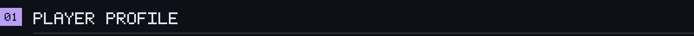
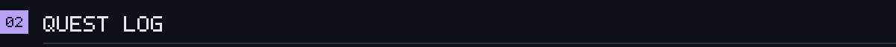
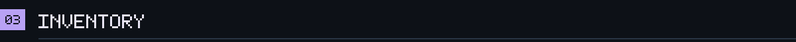
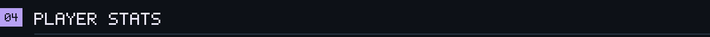
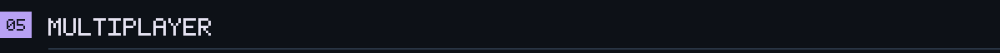

<p align="center">
  
</p>

<h1 align="center">Hi, I'm Harsh Surana</h1>
<p align="center"><strong>Developer · Web Development · Open Source · Problem Solving</strong></p>
<p align="center">Exploring AI &amp; contributing to open source<br />Building for the web &amp; cloud</p>

<p align="center">
  <a href="https://www.linkedin.com/in/harsh-surana-b07a5a380/">LINKEDIN</a> &nbsp; / &nbsp;
  <a href="mailto:harshsuran2006@gmail.com">EMAIL</a> &nbsp; / &nbsp;
  <a href="https://github.com/Harshsurana-hub?tab=repositories">REPOSITORIES</a>
</p>



```text
name       = "Harsh Surana"
interests  = ["Web Development", "Open Source", "Problem Solving"]
languages  = ["JavaScript", "TypeScript", "Python","Node.js"]
currently  = "Building projects and learning by contributing"
```

I enjoy building web projects and improving my skills through hands-on development. I also practice problem solving and contribute to open-source projects.



| Project | What it is | Stack | Links |
| --- | --- | --- | --- |
| [ShopSphere](https://github.com/vikas0799/shopsphere) | Full-stack e-commerce app. I contributed through the public fork and pull requests. | React, Vite, Node.js, Express, MongoDB | [Upstream](https://github.com/vikas0799/shopsphere) · [My fork](https://github.com/Harshsurana-hub/shopsphere) |
| [Oppia contribution](https://github.com/oppia/oppia/pull/27550) | Open pull request migrating an Android download acceptance test from Puppeteer to Playwright. | TypeScript, Playwright | [Pull request](https://github.com/oppia/oppia/pull/27550) |
| MargMitra — AWS AI for Bharat Hackathon | Participated with the team; shortlisted for the Prototype Development Phase. AI-powered navigation for rural users, offering natural-language route guidance in areas with limited connectivity. | AWS Lambda, AWS Bedrock, Python, JavaScript, serverless architecture | Hackathon project |






<div align="center">


</div>



Open to learning, building useful projects, and collaborating on open source.

[LinkedIn](https://www.linkedin.com/in/harsh-surana-b07a5a380/) · [Email](mailto:harshsuran2006@gmail.com) · [GitHub](https://github.com/Harshsurana-hub) · [LeetCode](https://leetcode.com/u/Harsh-Surana/) · [Codeforces](https://codeforces.com/profile/HarshSurana180) · [CodeChef](https://www.codechef.com/users/aspiro)

<p align="center"><sub>ONE PIXEL. ONE COMMIT. ONE ADVENTURE.</sub></p>
