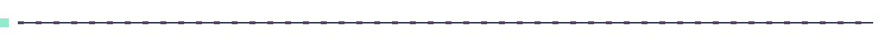
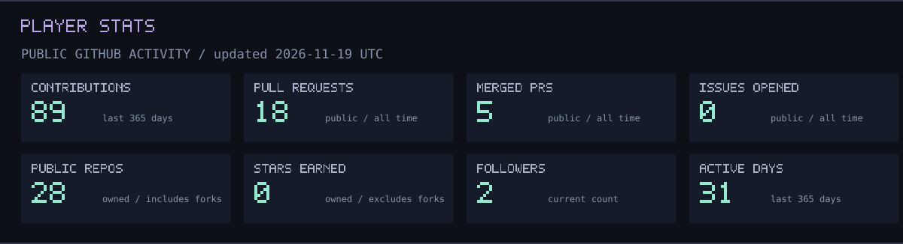
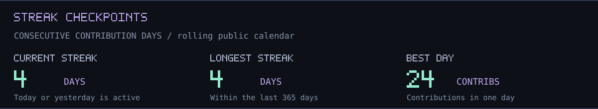
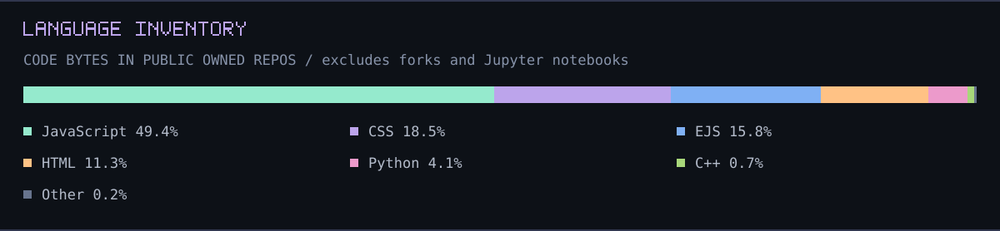
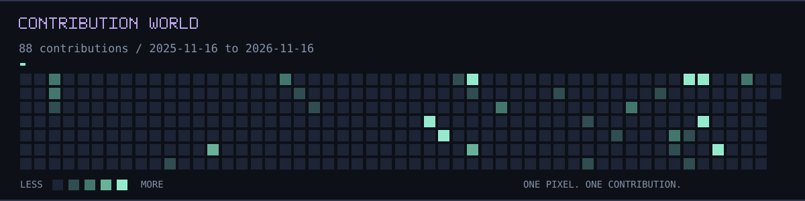

  

I’m **Harsh Surana**, a B.Tech Computer Science (AI & ML) student at Mirai School of Technology. I build web projects with React, JavaScript, and TypeScript, and practice data structures and algorithms in C++.

**Open to frontend and software engineering internships.** [Connect on LinkedIn](https://www.linkedin.com/in/harsh-surana-b07a5a380/)

## Selected projects

- **[Restaurant Menu & Table Order System](https://github.com/Harshsurana-hub/webd_assigment-sem-3/tree/main/restaurant-order)** — React and Express app with menu filters, table checkout, order tracking, and admin workflows. Uses Node.js and MongoDB.
- **[MargMitra](https://www.linkedin.com/feed/update/urn:li:activity:7444040910864109568/)** — My team’s navigation prototype for safer route choices. Shortlisted for the Prototype Development Phase of the AWS AI for Bharat Hackathon.

## Open source

- **[ShopSphere](https://github.com/vikas0799/shopsphere)** — Contributed to a full-stack e-commerce project built with React, Vite, Node.js, Express, and MongoDB. [My fork](https://github.com/Harshsurana-hub/shopsphere)
- **[Oppia #27550](https://github.com/oppia/oppia/pull/27550)** — Submitted a TypeScript migration of the Android download acceptance test from Puppeteer to Playwright. GitHub status: closed.

## Tools and practice

**Frontend:** React, JavaScript, TypeScript, HTML, CSS  
**Backend and testing:** Node.js, Express, MongoDB, Playwright  
**Problem solving:** C++ · [LeetCode](https://leetcode.com/u/Harsh-Surana/) · [Codeforces](https://codeforces.com/profile/HarshSurana180) · [CodeChef](https://www.codechef.com/users/aspiro)

GitHub activity

 

